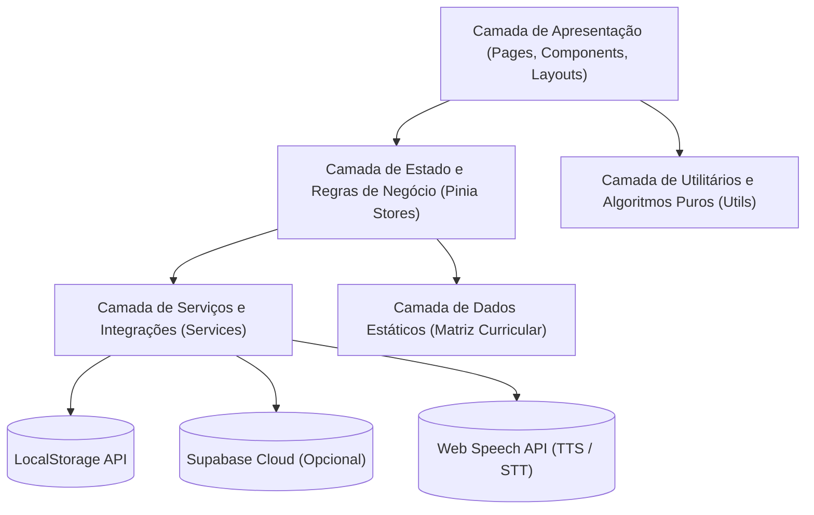
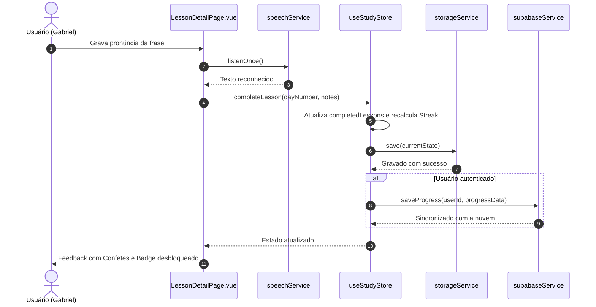

# Arquitetura do Sistema - English Study Pro (Web)

Este documento descreve a arquitetura técnica, divisão de camadas, fluxo de dados, estratégias de persistência e padrões de integração do projeto **English Study Pro**. Ele serve como fonte de verdade arquitetural para desenvolvedores e agentes autônomos de IA.

---

## 1. Visão Geral Arquitetural

O **English Study Pro** é uma aplicação web interativa baseada no paradigma **Single Page Application (SPA)**, focada no modelo educacional de microaprendizado diário (10 a 15 minutos ao longo de um programa estruturado de 90 dias).

### Princípios Norteadores
- **Offline-First Absoluto:** A aplicação é 100% funcional localmente sem depender de conexão com a internet ou servidores externos.
- **Graceful Degradation (Degradação Graciosa):** Recursos avançados como nuvem (Supabase) e reconhecimento de fala (Web Speech API) enriquecem a experiência se disponíveis, mas falhas ou ausência de credenciais nunca bloqueiam o fluxo básico de estudos do usuário.
- **Persistência Reativa e Desacoplada:** O estado em memória no Pinia é sincronizado transparentemente com o `LocalStorage` e opcionalmente espelhado no banco Supabase.

---

## 2. Organização em Camadas (Layered Architecture)

A estrutura de código está dividida em cinco camadas com responsabilidades bem delimitadas:

### 2.1 Camada de Apresentação (UI Layer)
- **Localização:** `src/pages/`, `src/layouts/`, `src/components/`
- **Responsabilidade:** Renderização da interface, captura de eventos do usuário, feedback visual e responsividade.
- **Tecnologias:** Vue 3 SFC (`<script setup>`), Quasar Framework v2 e SCSS customizado (*Eclipse Night*).
- **Regra:** Não executa mutações diretas de storage e não consome APIs de rede diretamente; consome exclusivamente Pinia Stores e funções de serviço encapsuladas.

### 2.2 Camada de Estado (State Layer)
- **Localização:** `src/stores/`
- **Módulos:**
  - `study.js`: Gerenciamento do ciclo das 90 lições, cálculo de streak, minutos de estudo e notas diárias.
  - `auth.js`: Estado da sessão do usuário no Supabase e sincronização de progresso.
  - `achievements.js`: Controle de conquistas desbloqueadas e gatilhos de recompensas.
  - `settings.js`: Preferências de interface (dark mode, áudio, sotaque, velocidade da voz).
- **Regra:** Mutações no estado são centralizadas em `actions`. Ao atualizar dados sensíveis ao progresso, a store invoca a persistência via `storageService` e dispara sincronização em nuvem caso haja autenticação ativa.

### 2.3 Camada de Serviços (Service Layer)
- **Localização:** `src/services/`
- **Módulos:**
  - `storage.js`: Abstração de serialização/desserialização segura no `LocalStorage`.
  - `speech.js`: Wrapper seguro para `window.speechSynthesis` e `SpeechRecognition` / `webkitSpeechRecognition`.
  - `supabase.js`: Inicialização segura do cliente Supabase e métodos de sincronização em nuvem com fallback defensivo.
  - `export.js`: Geração de relatórios PDF (`jsPDF`) e backups JSON / CSV.
- **Regra:** Isolar totalmente as dependências externas e APIs nativas do navegador. Se uma API não estiver disponível (ex: em navegadores sem Web Speech), o serviço deve falhar de modo silencioso e controlado.

### 2.4 Camada de Utilitários (Utils / Domain Algorithms)
- **Localização:** `src/utils/`
- **Módulos:**
  - `similarity.js`: Cálculo de distância de Levenshtein e cálculo percentual de similaridade de fala, além de sanitização de strings.
- **Regra:** Funções estritamente puras, sem efeitos colaterais e sem acoplamento com o ecossistema Vue/Quasar.

### 2.5 Camada de Dados Estáticos (Data Layer)
- **Localização:** `src/data/`
- **Módulos:**
  - `lessonsData.js`: Matriz curricular completa dos 90 dias com frases, traduções, dicas de vocabulário e pronúncia.
- **Regra:** Coleção estática imutável. Não deve ser mutada em tempo de execução.

---

## 3. Fluxo de Dados e Ciclo de Vida da Aplicação

### 3.1 Ciclo de Estudo e Persistência

---

## 4. Roteamento e Hierarquia de Layout

Configurado em `src/router/index.js`:
- `/login`: Página de autenticação isolada (fora do `MainLayout`).
- `/`: Envolvido por `MainLayout.vue` contendo:
  - Header com informações de streak e perfil.
  - Drawer de navegação para Desktop.
  - Bottom Bar de navegação para Mobile.
  - Rotas filhas com lazy loading:
    - `""` $\rightarrow$ `DashboardPage.vue`
    - `"lessons"` $\rightarrow$ `LessonsPage.vue`
    - `"lessons/:id"` $\rightarrow$ `LessonDetailPage.vue`
    - `"statistics"` $\rightarrow$ `StatisticsPage.vue`
    - `"achievements"` $\rightarrow$ `AchievementsPage.vue`
    - `"settings"` $\rightarrow$ `SettingsPage.vue`
- `/:catchAll(.*)*`: Redirecionamento defensivo para `/`.

---

## 5. Diretriz de Desacoplamento de Stores (Circular Dependencies)

### Diagnóstico de Débito Técnico
Atualmente, `study.js`, `achievements.js` e `settings.js` comunicam-se com `auth.js` usando imports dinâmicos (`import('./auth')`), enquanto componentes e layouts importam ambos de forma estática. Isso gera warnings no empacotador Vite (`[INEFFECTIVE_DYNAMIC_IMPORT]`).

### Solução Arquitetural Recomendada
Para agentes e desenvolvedores que alterarem a camada de estado:
1. **Evitar acoplamento horizontal entre stores:** Uma store não deve chamar diretamente a persistência de outra store.
2. **Orquestrador de Sincronização:** Centralizar a sincronização de nuvem no próprio `useAuthStore` ou em um serviço coordenador (`syncService`), registrando watchers ou assinantes no ciclo de inicialização de `main.js`.
