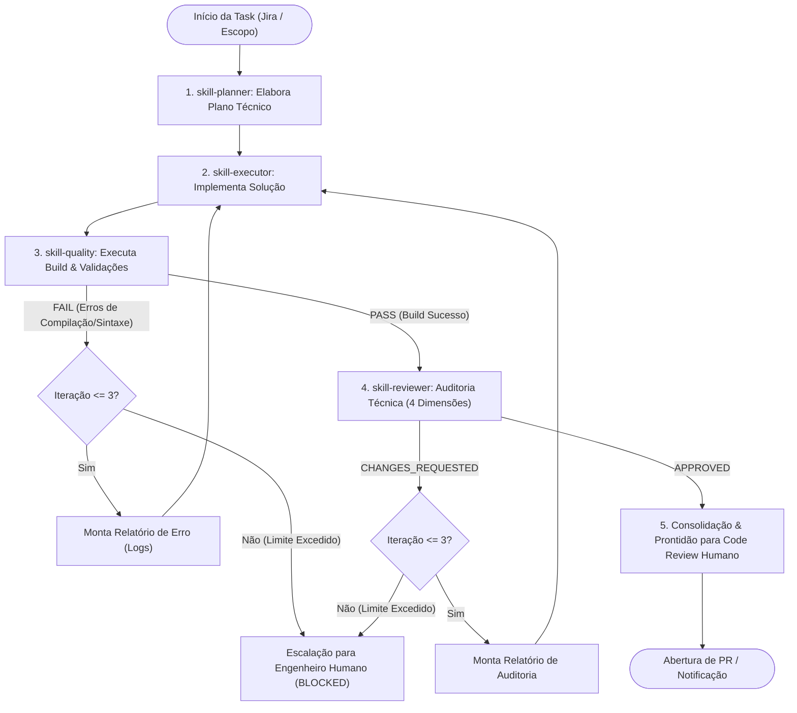

# Loop Autônomo de Refinamento (Autocorreção) - English Study Pro

Este documento especifica o fluxo operacional e os critérios de decisão do **Loop Autônomo de Refinamento**. O objetivo deste mecanismo é garantir que nenhuma alteração chegue ao desenvolvedor humano sem ter passado por múltiplos filtros automatizados de integridade, compilação e qualidade.

---

## 1. Fluxograma de Execução do Loop

---

## 2. Passo a Passo do Ciclo Operacional

### Fase 1: Planejamento Determinístico
- A `skill-planner` consome a User Story ou issue do Jira.
- Cruza os requisitos com a arquitetura descrita em [.agent/docs/architecture.md](file:///home/gabriel/projetos/english_daily_web/.agent/docs/architecture.md) e as diretrizes de [.agent/docs/guidelines-for-agents.md](file:///home/gabriel/projetos/english_daily_web/.agent/docs/guidelines-for-agents.md).
- Emite o documento `[PLANO DE EXECUÇÃO] <TASK-ID>` com o mapeamento exato de arquivos e o checklist sequencial.

### Fase 2: Implementação
- A `skill-executor` recebe o plano gerado na Fase 1.
- Caso seja a primeira iteração, implementa o código seguindo as convenções de [.agent/docs/conventions.md](file:///home/gabriel/projetos/english_daily_web/.agent/docs/conventions.md).
- Caso seja uma iteração de correção ($N > 1$), consome os logs de erro ou apontamentos de review anteriores, aplicando correções cirúrgicas sem desestabilizar o restante do código.

### Fase 3: Validação de Qualidade (Build & Sintaxe)
- A `skill-quality` executa o comando `npm run build` e linters disponíveis.
- **Se houver falha de compilação ou syntax error:**
  - O loop é interrompido nesta etapa.
  - O log cru do erro é empacotado e redirecionado para a `skill-executor`.
- **Se o build passar com sucesso (exit code 0):**
  - O fluxo prossegue automaticamente para a auditoria da Fase 4.

### Fase 4: Auditoria Técnica (Code Review de IA)
- A `skill-reviewer` analisa o diff gerado nas 4 categorias obrigatórias:
  1. **Arquitetura:** Preservação do *Offline-First*, separação de camadas, ausência de mutação de storage na UI.
  2. **Segurança:** Ausência de credenciais em código e prevenção de XSS (`v-html`).
  3. **Performance:** Reatividade otimizada (`computed`), debounce em saves de notas.
  4. **Estilo:** Composition API (`<script setup>`), JSDoc e paleta *Eclipse Night*.
- **Se houver não conformidades:** Emite parecer `CHANGES_REQUESTED`.
- **Se tudo estiver em conformidade:** Emite parecer `APPROVED`.

---

## 3. Critérios de Parada e Gestão de Limites do Loop

Para evitar loops infinitos ou consumo descontrolado de tokens, o orquestrador do loop adota as seguintes regras determinísticas:

| Condição | Ação do Orquestrador | Destino |
| :--- | :--- | :--- |
| `quality` = PASS E `reviewer` = APPROVED | Consolida commit, cria branch e abre PR | **Revisão Humana** |
| `quality` = FAIL ou `reviewer` = CHANGES_REQUESTED (Iteração $\le$ 3) | Incrementa contador ($i = i + 1$), entrega relatório de correção | **skill-executor** |
| Contador de iterações atinge o limite ($i = 3$) sem aprovação | Interrompe o loop autônomo, gera relatório de diagnóstico | **Escalação Humana (Blocked)** |

### Protocolo em Caso de Escalação (Limite Excedido)
Quando o agente atinge 3 tentativas sem sucesso:
1. Reverte o workspace para o último estado estável da branch base ou mantém a branch de debug isolada (`debug/TASK-ID-failed-loop`).
2. Adiciona um comentário na issue do Jira:
   > ⚠️ **[Agente Autônomo - Bloqueio Técnico]:** A task `TASK-ID` atingiu o limite de 3 iterações de autocorreção. Motivo da retenção: `[Log de Erro / Inconformidade Arquitetural]`. Intervenção humana necessária.
3. Altera o status no Jira para **"Blocked / Needs Human Assistance"**.
