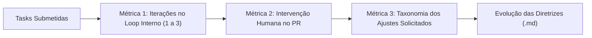
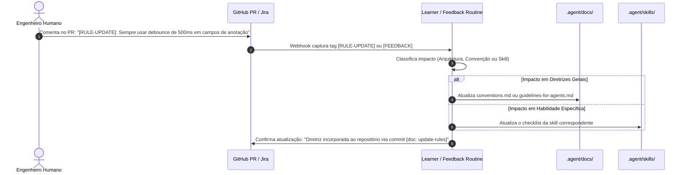

# Ciclo de Melhoria Contínua e Feedback Loops - English Study Pro

Este documento define os mecanismos de telemetria, coleta de métricas e o protocolo de retroalimentação contínua para evolução do ecossistema de agentes autônomos no repositório **English Study Pro**.

---

## 1. Coleta de Métricas Operacionais

Para medir a maturidade e a confiabilidade dos agentes, cada execução é registrada em um log estruturado mantido em `.agent/metrics/task-history.jsonl`.

### 1.1 Indicadores-Chave de Desempenho (KPIs)



1. **Taxa de Autocorreção Inicial (First-Pass Accuracy):**
   - Percentual de tasks concluídas com apenas 1 iteração (sem precisar de retry de qualidade ou review interno).
2. **Índice de Iterações até Estabilização ($I_{avg}$):**
   - Média de iterações necessárias entre a `skill-executor`, `skill-quality` e `skill-reviewer`.
3. **Volume de Ajustes Solicitados pelo Revisor Humano (Human Rework Rate):**
   - Número de comentários com pedidos de alteração feitos no Pull Request pós-aprovação do agente.
4. **Taxonomia dos Feedbacks Humanos:**
   - **Arquitetura:** Falha de separação de camadas, chamadas inadequadas de persistência.
   - **Regra de Negócio / Domínio:** Entendimento incorreto do syllabus das 90 lições ou gamificação.
   - **Design / UX:** Desalinhamento com o *Eclipse Night*, espaçamento ou responsividade em mobile.
   - **Estilo de Código:** Violação de convenções de nomenclatura ou ausência de documentação.

---

## 2. Formato do Registro de Telemetria (`task-history.jsonl`)

Cada ciclo de automação grava uma linha JSON com o seguinte schema:

```json
{
  "timestamp": "2026-11-06T18:22:00-03:00",
  "taskId": "ENG-105",
  "internalIterations": 2,
  "internalQualityPassed": true,
  "internalReviewPassed": true,
  "humanPrStatus": "CHANGES_REQUESTED",
  "humanFeedbackCategory": "Style",
  "humanCommentSummary": "Faltou adicionar JSDoc em exportService.importFromJSON",
  "knowledgeBaseUpdated": true
}
```

---

## 3. Protocolo de Retroalimentação Automática (Self-Learning Routine)

Quando um revisor humano aponta uma falha ou requisito repetido em um PR, o protocolo de aprendizado do agente é acionado para evitar a recorrência do mesmo erro.



### 3.1 Regras de Atualização Automática de Diretrizes
- **Se o apontamento for sobre nomenclatura, formatação ou anti-padrão:**
  - O sistema adiciona uma nova entrada na seção correspondente de [.agent/docs/conventions.md](file:///home/gabriel/projetos/english_daily_web/.agent/docs/conventions.md).
- **Se o apontamento for sobre fluxo de dados, storage ou dependências:**
  - O sistema atualiza [.agent/docs/architecture.md](file:///home/gabriel/projetos/english_daily_web/.agent/docs/architecture.md) e [.agent/docs/guidelines-for-agents.md](file:///home/gabriel/projetos/english_daily_web/.agent/docs/guidelines-for-agents.md).
- **Se o erro passou despercebido pela `skill-reviewer`:**
  - A matriz de auditoria da [skill-reviewer.md](file:///home/gabriel/projetos/english_daily_web/.agent/skills/skill-reviewer.md) é enriquecida com uma nova checagem obrigatória no checklist.
