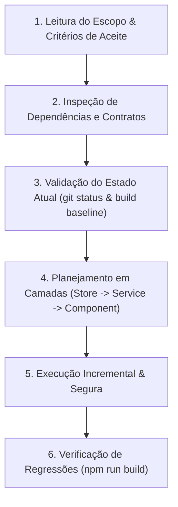

# Diretrizes Operacionais para Agentes de IA - English Study Pro

Este documento estabelece as regras de raciocínio, protocolo de análise, fluxos de modificação e critérios de validação que qualquer **Agente Autônomo de IA** deve seguir rigorosamente ao interagir com o repositório **English Study Pro**.

---

## 1. Princípios Inegociáveis (As Regras de Ouro)

1. **Preservação Absoluta do Offline-First:**
   Nenhuma funcionalidade pode falhar ou bloquear o usuário caso não haja conexão com a internet ou caso o Supabase não esteja provisionado. Toda lógica deve primeiro resolver e persistir localmente no `localStorage` através do `storageService`.
2. **Compatibilidade Retroativa de Dados do Usuário:**
   O schema persistido no `localStorage` (`english-study-app`) contém o histórico real de estudo, notas e streaks do usuário. **Nunca** altere o formato das chaves (`completedLessons`, `notes`, `studyDates`, `streak`, `totalMinutes`) sem implementar rotinas de migração defensiva com valores default.
3. **Fidelidade ao Design System "Eclipse Night":**
   Todas as novas telas, diálogos e componentes devem seguir a estética Dark Neon Glassmorphism. Não utilize estilos claros descontextualizados nem ignore as variáveis em `src/css/quasar-variables.sass`.
4. **Isolamento de Efeitos Colaterais:**
   Toda manipulação de APIs de navegador (`speechSynthesis`, `webkitSpeechRecognition`, `localStorage`) deve passar estritamente pela camada de `services/`. Componentes não devem acessar diretamente essas APIs globais.

---

## 2. Protocolo de Leitura e Raciocínio (Mindset do Agente)

Antes de gerar ou modificar qualquer arquivo, o agente deve seguir esta ordem mental:



### 2.1 Inspeção de Contratos Existentes
- Ao alterar lições: leia [lessonsData.js](file:///home/gabriel/projetos/english_daily_web/src/data/lessonsData.js) para manter o formato de objetos `{ day, title, category, phrases, tips }`.
- Ao alterar lógica de estudo: leia [study.js](file:///home/gabriel/projetos/english_daily_web/src/stores/study.js) e [storage.js](file:///home/gabriel/projetos/english_daily_web/src/services/storage.js).
- Ao alterar autenticação/nuvem: leia [supabase.js](file:///home/gabriel/projetos/english_daily_web/src/services/supabase.js) e [auth.js](file:///home/gabriel/projetos/english_daily_web/src/stores/auth.js).

---

## 3. Protocolo de Modificação Segura (Checklist de Execução)

Para garantir integridade técnica, o agente deve executar as seguintes ações:

### Passo 1: Baseline Check
Executar `npm run build` ou inspecionar se a árvore de trabalho está íntegra antes de iniciar alterações.

### Passo 2: Implementação Respeitando Camadas
1. Se a feature exigir novo dado de negócio $\rightarrow$ crie o método na Store do Pinia correspondente.
2. Se a feature exigir I/O externo $\rightarrow$ crie ou estenda o método no Service correspondente com tratamento de `try/catch`.
3. Se a feature for visual $\rightarrow$ crie componentes reaproveitáveis em `src/components/` ou monte a página em `src/pages/` usando Quasar + Composition API (`<script setup>`).

### Passo 3: Verificação de Build
Após qualquer modificação de código, rodar:
```bash
npm run build
```
O build deve passar com **código de saída 0**. Warnings como `[INEFFECTIVE_DYNAMIC_IMPORT]` devem ser evitados e eliminados sempre que possível.

---

## 4. Segurança e Gestão de Variáveis Sensíveis

- **Nunca comitar segredos:** Arquivos `.env` locais nunca devem ser alterados com dados sensíveis de produção em commits públicos.
- **Defensiva em Variáveis de Ambiente:** Qualquer leitura de `import.meta.env.VITE_*` deve conter valor de fallback seguro:
  ```javascript
  const supabaseUrl = import.meta.env.VITE_SUPABASE_URL || ''
  ```
- **Prevenção de XSS:** Nunca usar `v-html` diretamente com conteúdos textuais provenientes de input do usuário ou de transcrições de áudio. Utilize interpolação `{{ text }}`.
