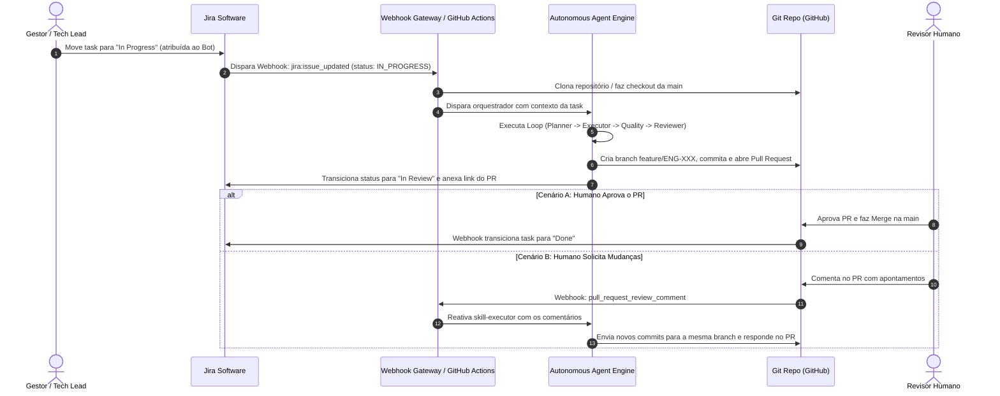

# Pipeline de Automação End-to-End (Jira & Git) - English Study Pro

Este documento apresenta o blueprint técnico da infraestrutura de automação contínua que conecta o ciclo de vida de tarefas no **Jira Software**, os agentes autônomos no repositório local e a entrega contínua via **Git / GitHub**.

---

## 1. Visão Geral da Arquitetura do Pipeline

---

## 2. Componentes da Solução Técnica

### 2.1 Trigger (Jira Webhook $\rightarrow$ CI/CD)
- **Evento Monitorado:** Transição de status da Issue para `"In Progress"` com `assignee.accountId == "AI_AGENT_BOT"`.
- **Payload Extraído:**
  - `issue.key`: Chave da tarefa (ex: `ENG-105`).
  - `issue.fields.summary`: Título da tarefa.
  - `issue.fields.description`: Descrição completa e critérios de aceite.

### 2.2 Motor de Processamento do Agente (`.agent/scripts/run-task.sh`)
- Executado em container efêmero ou runner dedicado:
  1. Cria branch isolada: `git checkout -b feature/${ISSUE_KEY}`.
  2. Executa a `skill-planner` para montar o checklist em memória.
  3. Aciona a `skill-executor` para aplicar o código.
  4. Executa `npm run build` via `skill-quality`.
  5. Aciona a `skill-reviewer` para checagem estática de arquitetura e segurança.
  6. Se aprovado, faz commit assinado: `feat(${ISSUE_KEY}): <Título da Tarefa>`.

### 2.3 Entrega (Pull Request Padronizado)
- Utiliza a CLI oficial do GitHub (`gh pr create`) com template automatizado contendo:
  - Identificador da tarefa no Jira.
  - Resumo executivo da implementação.
  - Checklist de validações técnicas executadas pela `skill-quality`.
  - Parecer de auditoria da `skill-reviewer`.

### 2.4 Ciclo de Interação Humana
- **Aprovação:** O merge na branch `main` dispara webhook que atualiza a issue no Jira para `"Done"`.
- **Ajustes:** Comentários no PR disparam nova execução do agente na mesma branch, aplicando correções incrementais sem recriar o PR.
